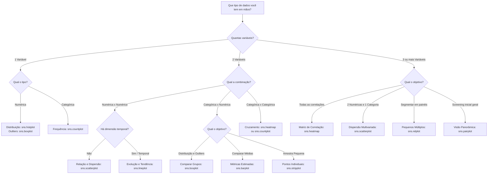

# 📊 Guia Definitivo de Seaborn

Na Ciência de Dados aplicada a consultorias e empresas de inovação, a visualização de dados cumpre três funções críticas:

1. **Diagnóstico Exploratório (EDA):** Entender a distribuição matemática das features e detectar problemas nos dados antes de rodar qualquer algoritmo.
2. **Engenharia de Features & Seleção:** Identificar multicolinearidade, assimetrias que exigem transformações e separabilidade entre classes.
3. **Comunicação Executiva (Data Storytelling):** Apresentar descobertas para diretores e clientes de negócios sem jargões desnecessários, com clareza visual absoluta.

Apenas **~20% das funções do Seaborn** cobrem **~80% dos desafios reais**. Este guia ensina não apenas **como plotar**, mas principalmente **como ler e o que fazer** diante de cada padrão visual.

---

## 🧭 O Mapa Mental da Arquitetura: *Axes-level* vs *Figure-level*

Antes do código, entenda como o Seaborn funciona por baixo do capô. Ele possui duas famílias de funções:

```
                           BIBLIOTECA SEABORN
                                   │
         ┌─────────────────────────┴─────────────────────────┐
         ▼                                                   ▼
   [Axes-level]                                        [Figure-level]
   Plota em um matplotlib.Axes existente               Cria e gerencia sua própria Figure
   (Compatível com plt.subplots)                       (Gera um FacetGrid automático)
         │                                                   │
  Funções:                                            Funções:
  • histplot()                                        • displot()
  • scatterplot()                                     • relplot()
  • boxplot() / barplot()                             • catplot()
  • heatmap()                                         • pairplot()
```

### Qual a diferença prática para o seu fluxo de trabalho?

| Aspecto                     | **Axes-level** (ex: `scatterplot`, `boxplot`)  | **Figure-level** (ex: `relplot`, `catplot`)        |
| :-------------------------- | :------------------------------------------------------- | :----------------------------------------------------------- |
| **Aceita `ax=`?**   | **Sim** (cabe em grids customizados do Matplotlib) | **Não** (sempre cria uma janela própria)             |
| **Ajuste de tamanho** | Via Matplotlib:`plt.figure(figsize=(10, 5))`           | Nos parâmetros:`height=5, aspect=1.5`                     |
| **Melhor uso**        | Gráficos individuais refinados e layouts complexos      | "Pequenos múltiplos" (fatiar em colunas/linhas com`col=`) |

---

## 🧭 Matriz de Decisão: Qual Gráfico Usar para os Meus Dados?

Em qualquer Análise Exploratória (EDA), a escolha do gráfico **nunca deve ser aleatória**. Ela é determinada estritamente por duas perguntas fundamentais:

1. **Quantas variáveis estou analisando simultaneamente?** (Univariada = 1, Bivariada = 2, Multivariada = 3+)
2. **Qual é o tipo estatístico de cada uma dessas variáveis?**
   - **Numérica Contínua:** Medições infinitamente divisíveis (ex: faturamento, peso, tempo, temperatura).
   - **Numérica Discreta:** Contagens inteiras (ex: quantidade de compras, número de filhos).
   - **Categórica Nominal:** Rótulos sem ordem intrínseca (ex: filial, gênero, meio de pagamento, churn).
   - **Categórica Ordinal:** Classes com hierarquia natural (ex: escolaridade, faixa de renda, avaliação de 1 a 5 estrelas).
   - **Temporal:** Sequência cronológica ordenada (ex: datas, meses, trimestres, timestamps).

### 🌳 Árvore de Decisão Rápida para EDA



---

### 📋 Tabela de Seleção: Tipo de Dado ➔ Gráfico Apropriado

| Combinação de Tipos                   | Pergunta do Negócio / Análise                                        | Gráfico Recomendado no Seaborn                                    | Por que este gráfico e não outro?                                                                  |
| :-------------------------------------- | :--------------------------------------------------------------------- | :----------------------------------------------------------------- | :--------------------------------------------------------------------------------------------------- |
| **1 Numérica**                   | Como a feature se comporta? É normal? Tem cauda longa?                | `sns.histplot(data, x="valor", kde=True)`                        | Mostra simultaneamente a frequência em barras e a curva suave de densidade estimada.                |
| **1 Numérica**                   | Onde estão os 50% centrais e existem valores anômalos?               | `sns.boxplot(data, x="valor")`                                   | Mostra os 5 números de Tukey (mín, Q1, mediana, Q3, máx) e destaca outliers matemáticos.         |
| **1 Numérica**                   | Qual percentual dos registros está abaixo de certo patamar?           | `sns.ecdfplot(data, x="valor")`                                  | Mostra a função acumulada empírica (ótimo para regras como "80% das compras são até R$ 100").  |
| **1 Categórica**                 | Qual o volume de cada categoria no banco de dados?                     | `sns.countplot(data, x="categoria")`                             | Conta as linhas automaticamente, evidenciando classes desbalanceadas.                                |
| **Numérica x Numérica**         | Existe correlação, agrupamentos ou relação não-linear?            | `sns.scatterplot(data, x="idade", y="renda")`                    | Exibe cada observação individual como uma coordenada cartesiana pura.                              |
| **Numérica x Temporal**          | Como a métrica evoluiu ao longo dos meses/anos?                       | `sns.lineplot(data, x="data", y="vendas")`                       | Conecta pontos cronologicamente e calcula intervalo de confiança automático para dados agregados.  |
| **Categórica x Numérica**       | Como a métrica se dispersa e varia entre diferentes categorias?       | `sns.boxplot(data, x="depto", y="salario")`                      | Permite comparar medianas e amplitude de variabilidade de vários grupos lado a lado sem poluição. |
| **Categórica x Numérica**       | Qual grupo possui a maior média estimada (com margem de erro)?        | `sns.barplot(data, x="canal", y="conversao")`                    | Estima a média populacional e plota o intervalo de confiança para validar significância visual.   |
| **Categórica x Categórica**     | Como duas variáveis qualitativas se cruzam (tabela de contingência)? | `sns.heatmap(pd.crosstab(df["plano"], df["churn"]), annot=True)` | Exibe o volume de intersecções com escala de cores (ex: Churn em planos Mensais vs Anuais).        |
| **Múltiplas Numéricas (3+)**    | Quais atributos têm multicolinearidade para Machine Learning?         | `sns.heatmap(df.corr(), annot=True, cmap="coolwarm")`            | Resume dezenas de relações bivariadas em uma matriz compacta com coeficientes de -1 a +1.          |
| **2 Numéricas + 1 Categórica**  | A relação entre X e Y muda dependendo da categoria?                  | `sns.scatterplot(x="peso", y="altura", hue="genero")`            | Adiciona a 3ª dimensão colorindo os pontos sem precisar de gráfico 3D confuso.                    |
| **2 Numéricas + 2 Categóricas** | Como a relação se comporta em diferentes nichos/segmentos?           | `sns.relplot(x="gasto", y="visitas", hue="sexo", col="regiao")`  | Cria uma grade de gráficos separados por região, mantendo a escala padronizada.                    |

---

### ⚠️ Armadilhas Clássicas: Gráficos Errados que Reprovam em Entrevistas

1. **Usar `sns.lineplot` para variáveis nominais no eixo X:**
   * ❌ **Erro:** Ligar "Filial A", "Filial B" e "Filial C" com uma linha contínua.
   * 💡 **Por que é errado?** Linhas implicam continuidade temporal ou física. Ligar filiais inventa uma relação de passagem que não existe. Para categorias sem ordem, use `barplot` ou `boxplot`.
2. **Usar `sns.barplot` para avaliar distribuição e dispersão:**
   * ❌ **Erro:** Usar barras para tentar ver se há outliers ou se a distribuição é assimétrica.
   * 💡 **Por que é errado?** A barra esconde todos os dados e resume tudo a um único ponto (a média). Se um grupo tiver metade dos clientes com 0 e metade com 100, a média é 50, mas nenhum cliente tem 50. Use `boxplot` ou `violinplot`.
3. **Usar `sns.scatterplot` com centenas de milhares de pontos sem transparência:**
   * ❌ **Erro:** Plotar 200.000 pontos em que uma mancha preta sólida tampa tudo (*overplotting*).
   * 💡 **Como corrigir?** Use `alpha=0.2` no scatterplot ou substitua por um mapa de densidade 2D hexagonal (`sns.jointplot(kind="hex")`).
4. **Gráficos de Pizza (Pie Charts):**
   * ❌ O Seaborn deliberadamente **não possui** função para gráfico de pizza. O cérebro humano é péssimo comparando ângulos e áreas. Em consultoria, utilize sempre `barplot` ou `countplot`.

---

## 📥 Importação de Datasets Nativos do Seaborn

O Seaborn possui um repositório interno de datasets clássicos já no formato *tidy data* (DataFrame do Pandas), prontos para estudo, sem necessidade de baixar arquivos CSV manuais.

### 1. Como listar todos os datasets disponíveis

Você pode consultar a lista completa com todas as bases embutidas em uma única linha:

```python
import seaborn as sns

# Retorna uma lista de strings com os nomes de todos os datasets disponíveis
nomes = sns.get_dataset_names()
print(f"Total de datasets disponíveis: {len(nomes)}")
print(nomes[:10])  # Exibe os 10 primeiros
```

### 2. Como carregar um dataset

Para carregar, utilize a função `sns.load_dataset("nome")`. O retorno é **100% um `pandas.DataFrame`**:

```python
# Carregamento instantâneo
df_tips = sns.load_dataset("tips")
df_penguins = sns.load_dataset("penguins")

# Inspecionando como qualquer DataFrame normal
print(df_tips.head())
print(df_tips.info())
```

### 3. Os 5 Melhores Datasets para Estudar para Entrevistas de Dados

| Dataset                | Tipo de Problema de Negócio                            | Variáveis Chave                                                                 |
| :--------------------- | :------------------------------------------------------ | :------------------------------------------------------------------------------- |
| **`penguins`** | Classificação Multiclasse e Relações Biométricas   | Espécie (`species`), ilha, medidas de bico, nadadeira e massa corporal.       |
| **`tips`**     | Regressão e Análise de Consumo em Varejo/Serviços    | Valor da conta (`total_bill`), gorjeta (`tip`), sexo, fumante, dia e turno.  |
| **`titanic`**  | Classificação Binária e Tratamento de Nulos          | Sobrevivência (`survived`), classe social (`pclass`), sexo, idade e tarifa. |
| **`flights`**  | Séries Temporais, Sazonalidade e Decomposição        | Ano (`year`), mês (`month`) e total de passageiros (`passengers`).        |
| **`diamonds`** | Dados Massivos (>50k linhas) e Relações Não-Lineares | Quilates (`carat`), corte (`cut`), cor, claridade e preço (`price`).      |

> 💡 **Dica Prática (Uso Offline):** O Seaborn faz o download dos dados do repositório oficial na primeira execução e salva em cache no seu computador (`~/.cache/seaborn/`). Se você quiser garantir acesso offline ou simular leitura de arquivos reais em projetos de portfólio, salve em CSV local:
>
> ```python
> df_penguins.to_csv("penguins.csv", index=False)
> ```

---

## 🔬 Os 6 Gráficos Essenciais: Código, Interpretação e Decisão

```python
import seaborn as sns
import matplotlib.pyplot as plt
import pandas as pd
import numpy as np

# Configuração de tema corporativo limpo
sns.set_theme(style="whitegrid", font_scale=1.05)

# Carregamento de dados para prática
penguins = sns.load_dataset("penguins")
tips = sns.load_dataset("tips")
```

---

### 1. Histograma & Densidade: `sns.histplot(kde=True)`

* **Finalidade:** Radiografia da distribuição de uma variável numérica contínua.
* **Código:**

```python
plt.figure(figsize=(8, 4))
sns.histplot(
    data=penguins, 
    x="body_mass_g", 
    kde=True,          # Curva de densidade contínua (Kernel Density Estimation)
    hue="species",     # Segmenta as distribuições por categoria
    bins=25,
    alpha=0.6
)
plt.title("Distribuição da Massa Corporal por Espécie de Pinguim")
plt.xlabel("Massa Corporal (g)")
plt.ylabel("Frequência de Indivíduos")
plt.show()
```

#### 🧠 Como Ler e Interpretar:

* **Formato em Sino (Gaussiana/Normal):** A maioria dos dados está centrada na média; média e mediana são muito próximas. Modelos lineares funcionam de forma ideal aqui.
* **Assimetria Positiva (Cauda Longa à Direita):** A maioria dos valores se concentra à esquerda (valores baixos), mas existem poucos valores muito altos puxando a média para cima (ex: salários, faturamento, preços de imóveis).
  * *Efeito:* A média é maior que a mediana ($Média > Mediana$).
  * *Decisão de Modelagem:* Modelos lineares sofrem com isso. Aplique uma transformação logarítmica (`np.log1p(x)`) para normalizar a distribuição.
* **Assimetria Negativa (Cauda Longa à Esquerda):** Poucos valores muito baixos puxam a cauda para a esquerda ($Média < Mediana$).
* **Bimodalidade (Dois ou Mais Picos na Curva KDE):** Sinal vermelho! Indica que a coluna mistura duas populações distintas (ex: pinguins fêmeas e machos, ou clientes corporativos e pessoas físicas).
  * *Decisão de Modelagem:* Crie uma feature indicadora ou divida os modelos por segmento.

---

### 2. Dispersão e Relação: `sns.scatterplot()`

* **Finalidade:** Relação entre duas variáveis contínuas com capacidade de adicionar até 3 dimensões extras via estética (`hue`, `style`, `size`).
* **Código:**

```python
plt.figure(figsize=(8, 5))
sns.scatterplot(
    data=tips,
    x="total_bill",
    y="tip",
    hue="time",        # Cor: Almoço vs Jantar
    style="smoker",    # Formato do ponto: Fumante vs Não
    size="size",       # Tamanho da bolha: Número de pessoas na mesa
    sizes=(40, 200),
    alpha=0.8
)
plt.title("Relação entre Valor da Conta e Gorjeta")
plt.xlabel("Total da Conta ($)")
plt.ylabel("Gorjeta ($)")
plt.show()
```

#### 🧠 Como Ler e Interpretar:

* **Direção e Força da Relação:**
  * *Subindo da esquerda para a direita:* Correlação positiva (quando X cresce, Y cresce).
  * *Descendo:* Correlação negativa.
  * *Nuvem disforme/circular:* Ausência de correlação linear.
* **Linearidade vs Não-Linearidade:** Se os pontos formam uma curva parabólica ou exponencial, um modelo linear simples (`LinearRegression`) errará feio; será necessário termos polinomiais, árvores de decisão ou redes neurais.
* **Heterocedasticidade (Efeito Funil):** Os pontos começam próximos perto da origem e vão se espalhando cada vez mais conforme X cresce.
  * *Significado Real:* A incerteza de Y aumenta com X (ex: quem gasta \$10 dá gorjeta de \$1 a \$2; quem gasta \$100 varia de \$5 a \$30).
  * *Decisão de Modelagem:* Viola os pressupostos clássicos da regressão linear OLS.
* **Outliers Bivariados (Pontos de Alavancagem):** Pontos isolados longe da nuvem geral. Um cliente que pagou \$50 e deu \$1 de gorjeta não é um outlier univariado de conta nem de gorjeta, mas o par $(50, 1)$ é uma anomalia nítida na relação.

---

### 3. Estatística Descritiva e Outliers: `sns.boxplot()` & `sns.violinplot()`

* **Finalidade:** Comparar medianas, dispersão e anomalias entre diferentes grupos.
* **Código:**

```python
fig, axes = plt.subplots(1, 2, figsize=(13, 4.5))

# Boxplot: foco em quartis e outliers
sns.boxplot(
    data=tips,
    x="day",
    y="total_bill",
    hue="sex",
    palette="Set2",
    ax=axes[0]
)
axes[0].set_title("Quartis e Outliers de Conta por Dia")

# Violinplot: adiciona a densidade da distribuição
sns.violinplot(
    data=tips,
    x="day",
    y="total_bill",
    hue="sex",
    split=True,        # Divide o violino em duas metades comparativas
    palette="Pastel1",
    ax=axes[1]
)
axes[1].set_title("Densidade Bimodal e Dispersão por Dia")

plt.tight_layout()
plt.show()
```

#### 🧠 A Anatomia Exata do Boxplot:

```
           Outlier
              *
    ──┬──    <- Limite Superior: Q3 + 1.5 * IQR (não é o valor máximo da coluna!)
      │
   ┌──┴──┐   <- 3º Quartil (Q3, 75% dos dados estão abaixo desta linha)
   │  █  │   <- Mediana (Q2, 50% dos dados / traço central)
   └──┬──┘   <- 1º Quartil (Q1, 25% dos dados estão abaixo desta linha)
      │
    ──┴──    <- Limite Inferior: Q1 - 1.5 * IQR
              *
           Outlier
```

* **A Caixa Central (IQR = Q3 - Q1):** Contém os 50% centrais dos dados. Se a caixa de sábado é o dobro do tamanho da de quinta-feira, significa que o faturamento de sábado é muito mais instável e volátil.
* **A Linha da Mediana:** Se estiver colada na borda inferior da caixa, a distribuição é assimétrica à direita; se estiver no centro perfeito, é simétrica.
* **Os Pontos Além das Linhas (Outliers):** Valores além de $1.5 \times IQR$.
  * *O que fazer na prática:* **Nunca delete outliers automaticamente!** Em consultorias, um outlier pode representar fraude em cartão de crédito, compras corporativas atípicas ou falha de sensor. Investigue a causa antes de descartar.
* **Por que o Violinplot existe?** O Boxplot resume tudo a 5 números e pode **ocultar bimodalidade**. Se um grupo tiver dois picos (ex: contas muito baratas e contas muito caras), o boxplot mostra uma caixa comum. O violinplot mostra a "cintura fina" no meio, revelando o padrão oculto.

---

### 4. Agregações e Incerteza: `sns.barplot()` vs `sns.countplot()`

* **Finalidade:**
  * `countplot`: Contar volume absoluto de ocorrências (quantos clientes vieram?).
  * `barplot`: Calcular uma métrica agregada estimada (qual o valor médio do ticket?).
* **Código:**

```python
fig, axes = plt.subplots(1, 2, figsize=(12, 4.5))

# 1. Contagem Absoluta (Volumetria)
sns.countplot(
    data=tips,
    x="day",
    hue="day",
    legend=False,
    order=["Thur", "Fri", "Sat", "Sun"],
    palette="Blues_d",
    ax=axes[0]
)
axes[0].set_title("Volumetria de Mesas por Dia")

# 2. Média com Intervalo de Confiança
sns.barplot(
    data=tips,
    x="day",
    y="tip",
    hue="day",
    legend=False,
    order=["Thur", "Fri", "Sat", "Sun"],
    errorbar=("ci", 95),  # Barra de erro = intervalo de confiança de 95%
    palette="Greens_d",
    ax=axes[1]
)
axes[1].set_title("Gorjeta Média com Intervalo de Confiança (95%)")

plt.tight_layout()
plt.show()
```

#### 🧠 Como Ler a Barra de Erro (`errorbar`):

* **O que a barra no topo do `barplot` significa?** Ela representa a **incerteza estatística da média**. Com `errorbar=('ci', 95)`, ela indica que temos 95% de confiança de que a verdadeira média populacional está dentro daquele intervalo.
* **Regra de Decisão Visual (Significância Estatística sem Teste de Hipótese):**
  * *Se as barras de erro de dois grupos se sobrepõem muito:* Não há evidência estatística de que os grupos sejam diferentes na realidade. A variação pode ser puro ruído amostral.
  * *Se as barras de erro estão totalmente separadas (sem sobreposição):* A diferença entre as médias é muito provavelmente real e estatisticamente significativa.
  * *Em entrevistas/reuniões:* Dizer *"A média de domingo foi \$3.25 e a de sábado \$2.99, porém as barras de confiança de 95% se sobrepõem, portanto não podemos afirmar categoricamente que clientes de domingo pagam mais"* é o tipo de postura que demonstra maturidade sênior.

#### ⚙️ O `barplot` Calcula Obrigatoriamente a Média?

**Não!** A média aritmética é apenas o valor padrão (`estimator="mean"`). Você pode alternar a função agregadora com o parâmetro `estimator`:

* **`estimator="median"`**: Essencial quando a distribuição possui muitos *outliers* ou assimetria acentuada (ex: salários, faturamento e gorjetas), onde a mediana representa o centro típico com muito mais fidelidade.
* **`estimator="sum"`**: Calcula a soma acumulada de valores no grupo (ex: faturamento bruto total gerado em cada dia da semana).
* **Funções Customizadas / NumPy**: Aceita `estimator=np.std` (desvio padrão), `estimator="min"`, `estimator="max"` ou expressões `lambda`.

#### 🎛️ Customização da Barra de Erro (`errorbar`):

* **`errorbar=None`**: Oculta a barra de erro (muito recomendado ao usar `estimator="sum"` ou quando deseja um gráfico puramente executivo e limpo).
* **`errorbar="sd"`**: Exibe o **desvio padrão** da amostra (mostrando a dispersão real dos dados ao redor da média, e não o intervalo de confiança do estimador).
* **`errorbar=("ci", 90)`**: Ajusta o nível de confiança (ex: 90% ou 99% em vez dos 95% padrão).

---

### 5. Séries Temporais e Tendências: `sns.lineplot()`

* **Finalidade:** Evolução contínua ao longo do tempo ou de uma sequência ordenada.
* **Código:**

```python
flights = sns.load_dataset("flights")

plt.figure(figsize=(9, 4))
sns.lineplot(
    data=flights,
    x="year",
    y="passengers",
    errorbar=("ci", 95)  # Faixa sombreada = intervalo de confiança
)
plt.title("Evolução Média Anual de Passageiros")
plt.xlabel("Ano")
plt.ylabel("Média de Passageiros")
plt.show()
```

#### 🧠 Como Ler e Interpretar:

* **A Linha Central:** É a média estimada em cada ano/tempo.
* **A Faixa Sombreada:** É o intervalo de confiança gerado por *bootstrap* quando existem múltiplas observações por ponto no eixo X (por exemplo, os 12 meses de cada ano).
  * *Faixa estreita:* Alta precisão, pouca variabilidade interna no período.
  * *Faixa larga:* Grande volatilidade interna (ex: meses de férias têm muitos passageiros e meses de baixa temporada têm poucos, aumentando a amplitude).
* **Padrões a identificar:**
  * *Tendência (Trend):* Linha com inclinação contínua de alta ou queda.
  * *Sazonalidade:* Oscilações repetidas em intervalos fixos (visíveis se o eixo X for mês ou dia da semana).
  * *Mudança de regime (Quebra estrutural):* Quedas ou subidas abruptas após uma data (ex: impacto de uma pandemia ou lançamento de feature).

#### 🎨 Desmembrando Séries Temporais com `hue` e `style`:

Quando você tem categorias ao longo do tempo (ex: comparar produtos, regiões ou meses), o `hue` separa a série em **múltiplas linhas coloridas**, cada uma com sua própria trajetória e faixa de confiança:

```python
# 1. Comparando a evolução anual de cada mês separadamente:
plt.figure(figsize=(10, 5))
sns.lineplot(
    data=flights,
    x="year",
    y="passengers",
    hue="month",         # Cada mês ganha sua própria linha colorida
    palette="tab10"
)
plt.title("Evolução Mensal de Passageiros por Ano")
plt.legend(bbox_to_anchor=(1.05, 1), loc="upper left") # Move a legenda para fora
plt.show()
```

##### ⚡ Parâmetros Avançados para o `lineplot`:

* **`hue`**: Define a cor de cada série temporal com base em uma variável categórica.
* **`style`**: Altera a forma do traço da linha (contínua, tracejada, pontilhada) para uma segunda variável.
* **`markers=True`**: Adiciona marcadores (círculos, triângulos) nos pontos exatos onde há dados reais.
* **`dashes=False`**: Mantém todas as linhas sólidas/contínuas mesmo quando usar `style`.

```python
# 2. Exemplo clássico combinando hue e style (dataset fmri):
fmri = sns.load_dataset("fmri")

plt.figure(figsize=(9, 4.5))
sns.lineplot(
    data=fmri,
    x="timepoint",
    y="signal",
    hue="event",        # Cor: estim vs cue (estímulo vs repouso)
    style="region",     # Traço: parietal vs frontal (sólido vs tracejado)
    markers=True,       # Desenha marcadores nos pontos reais
    errorbar=("ci", 95) # Intervalo de confiança individual para cada curva
)
plt.title("Sinal Neural ao Longo do Tempo por Região e Evento")
plt.show()
```

---

### 6. Matriz de Correlação: `sns.heatmap()`

* **Finalidade:** Mapear a força e direção da associação linear entre todas as features numéricas do dataset.
* **Código:**

```python
plt.figure(figsize=(7, 5))
numeric_penguins = penguins.select_dtypes(include="number")
corr = numeric_penguins.corr(method="pearson")

sns.heatmap(
    corr,
    annot=True,         # Exibe o valor do coeficiente de correlação
    fmt=".2f",
    cmap="coolwarm",    # Azul = -1 (negativo), Branco = 0, Vermelho = +1 (positivo)
    vmin=-1, vmax=1,    # Trava a escala de cores entre -1 e +1
    linewidths=0.5,
    cbar_kws={"label": "Coeficiente de Pearson (r)"}
)
plt.title("Matriz de Correlação de Pearson")
plt.show()
```

#### 🧠 Como Ler e Decidir na Prática:

* **Escala de Pearson ($r$):**
  * $+1.0$: Correlação linear positiva perfeita.
  * $0.0$: Nenhuma relação linear detectável.
  * $-1.0$: Correlação linear negativa perfeita (quando X sobe, Y desce proporcionalmente).
* **Guia de Força:**
  * $|r| \ge 0.7$: Correlação **forte**.
  * $0.3 \le |r| < 0.7$: Correlação **moderada**.
  * $|r| < 0.3$: Correlação **fraca ou desprezível**.
* **Problema Crítico: Multicolinearidade em Machine Learning:**
  * Se duas variáveis independentes (ex: `flipper_length_mm` e `body_mass_g`) tiverem correlação $> 0.85$, elas carregam praticamente a **mesma informação redundante**.
  * *Efeito colateral:* Em regressões lineares e logísticas, isso explode a variância dos coeficientes (teste VIF alto), tornando o modelo instável e difícil de interpretar.
  * *Decisão:* Remova uma das duas features ou use técnicas de regularização (Ridge/Lasso) ou PCA.
* **Armadilha Mortal: Correlação $\neq$ Causalidade:**
  * Correlação mede apenas co-ocorrência matemática. Se a venda de sorvetes e o número de afogamentos têm $r = 0.9$, o sorvete não causa afogamento: a variável oculta (confounder) é a temperatura do verão. Em consultoria, nunca confunda correlação com causa.

---

### ⚡ Bônus: `sns.pairplot(corner=True)`

* **Finalidade:** Raio-X completo das primeiras horas com um dataset desconhecido.
* **Código:**

```python
sns.pairplot(
    data=penguins.dropna(),
    hue="species",      # Colore pela variável alvo
    corner=True,        # Plota só o triângulo inferior, economizando tempo e tela
    palette="Dark2"
)
plt.show()
```

#### 🧠 O que Procurar no Pairplot:

1. **Diagonal Principal (Distribuições):** Mostra a distribuição KDE de cada feature separada pelas classes da variável alvo (`hue`). Se uma curva de uma espécie estiver completamente separada das outras, você achou a **feature de ouro** para o modelo de classificação.
2. **Fora da Diagonal (Dispersões Bivariadas):** Verifique se os pontos coloridos formam agrupamentos bem separados ou se estão todos misturados. Classes bem separadas visualmente indicam que um modelo simples (ex: Regressão Logística ou Árvore rasa) terá alta acurácia imediata.

---

## 👔 O Checklist de Comunicação para Consultoria (Sauter Digital)

Ao apresentar análises visuais para líderes técnicos ou clientes corporativos, use esta estrutura de 4 passos:

```
┌───────────────────────────────────────────────────────────────┐
│ 1. Contexto: Qual pergunta de negócio estamos respondendo?    │
│ 2. Leitura Técnica: O que o gráfico mostra estatisticamente?  │
│ 3. Insight de Negócio: O que isso significa na prática?       │
│ 4. Recomendação/Ação: Qual o próximo passo sugerido?          │
└───────────────────────────────────────────────────────────────┘
```

### Exemplo Prático de Apresentação:

* ❌ **Amador:** *"Aqui temos o boxplot do valor da conta por dia da semana e sexo do cliente."*
* ✅ **Padrão Consultoria:** *"Analisamos a distribuição de faturamento por mesa nos fins de semana (Contexto). O boxplot revela que a mediana de sábado é \$18.2 com alta dispersão (IQR de \$14), além de 4 outliers acima de \$45 no turno da noite (Leitura Técnica). Isso indica que grupos corporativos maiores frequentam o restaurante aos sábados (Insight). Recomendamos direcionar garçons mais experientes para esse turno para elevar a conversão de itens premium (Recomendação)."*

---

## 📌 Resumo Comparativo: O que cada gráfico responde

| Se sua dúvida for...                                    | Gráfico Ideal             | Símbolo Visual Chave                                                        | O que inspecionar com atenção                          |
| :------------------------------------------------------- | :------------------------- | :--------------------------------------------------------------------------- | :------------------------------------------------------- |
| Qual a forma e simetria da feature?                      | `sns.histplot(kde=True)` | Pico e caudas                                                                | Assimetria positiva/negativa e múltiplos picos          |
| Onde estão os 50% centrais e as anomalias?              | `sns.boxplot()`          | Caixa (IQR) e pontos                                                         | Posição da mediana e pontos além de$1.5 \times IQR$ |
| A distribuição possui dois picos ocultos?              | `sns.violinplot()`       | Largura da densidade                                                         | Cinturas ou alargamentos múltiplos                      |
| Existe relação direta ou curva entre duas métricas?   | `sns.scatterplot()`      | Formato da nuvem                                                             | Inclinação, dispersão em funil e outliers             |
| Qual o volume absoluto de ocorrências?                  | `sns.countplot()`        | Altura da barra                                                              | Categorias desbalanceadas ou raras                       |
| Qual grupo tem o maior desempenho médio?                | `sns.barplot(errorbar)`  | Linha de erro no topo                                                        | Sobreposição das barras de confiança (95%)            |
| Quais variáveis são redundantes para Machine Learning? | `sns.heatmap(corr)`      | Cor e valor$-1$ a $+1$ | Coeficientes$|r| > 0.85$ (multicolinearidade) |                                                          |
| As classes do problema são fáceis de separar?          | `sns.pairplot(hue)`      | Cores dos pontos                                                             | Separação clara entre grupos em eixos específicos     |
